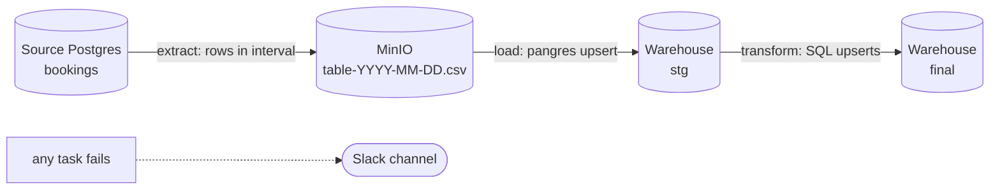

# Pac-Flights Incremental Data Pipeline

[](https://github.com/hudiyaresa/airflow-incremental-flightdata/actions/workflows/ci.yml)

An Airflow pipeline for a flight booking system that loads only what changed. Each daily run pulls the rows created or updated inside its own data interval, stages them in MinIO, upserts them into the warehouse, and rebuilds the star schema. Failures go to Slack.

This is the second project in a small series:

1. [airflow-elt-flightdata](https://github.com/hudiyaresa/airflow-elt-flightdata): full load, plain SQL transforms
2. **airflow-incremental-flightdata** (this repo): incremental load, upserts, Slack alerts
3. [airflow-dbt-flightdata](https://github.com/hudiyaresa/airflow-dbt-flightdata): transforms moved to dbt

## Table of Contents

1. [What changed from the full load version](#what-changed-from-the-full-load-version)
2. [Architecture](#architecture)
3. [How the incremental window works](#how-the-incremental-window-works)
4. [Pipeline Flow](#pipeline-flow)
5. [Project Structure](#project-structure)
6. [Getting Started](#getting-started)
7. [Backfill](#backfill)
8. [Testing and CI](#testing-and-ci)
9. [Screenshots](#screenshots)

## What changed from the full load version

| | Full load (repo 1) | Incremental (this repo) |
| --- | --- | --- |
| Rows per run | the whole table | rows created or updated in the run's interval |
| Staging write | insert, skip on conflict | `pangres` upsert, updates existing rows |
| MinIO object | `/temp/<table>.csv` | `/temp/<table>-<interval date>.csv`, one file per day |
| Empty tables | skipped | skipped, and the load task skips too (XCom status) |
| History | `catchup=False` | `catchup=True` from 2025-01-01, one run at a time |
| Alerting | none | Slack message with task, log URL and traceback |
| Config | hard coded lists | Airflow Variables imported from `include/variables.json` |

## Architecture

| Layer | Tool | Notes |
| --- | --- | --- |
| Source | PostgreSQL 16 | `bookings` schema (Pacflight airline demo data) |
| Data lake | MinIO | daily CSV files in `extracted-data` |
| Warehouse | PostgreSQL 16 | `stg` for upserted raw rows, `final` for dims and facts |
| Orchestrator | Apache Airflow 2.10.2 | LocalExecutor, task groups, XCom between extract and load |
| Alerting | Slack webhook | `on_failure_callback` on every task |
| Runtime | Docker Compose | one command brings everything up |




## How the incremental window works

Every Airflow run covers a half open interval `[data_interval_start, data_interval_end)`. For the daily schedule, the run with logical date `2025-01-02` covers `2025-01-02 00:00` up to, but not including, `2025-01-03 00:00`.

Extract sends that interval to Postgres as query parameters:

```sql
SELECT * FROM bookings.<table>
WHERE (created_at >= %(start)s AND created_at < %(end)s)
   OR (updated_at >= %(start)s AND updated_at < %(end)s);
```

Because the bounds come from the run and not from the wall clock:

- rerunning a day gives the same rows, and the upsert makes the result the same too
- backfilling a past range works without code changes
- nothing is formatted into the SQL string, so there is no quoting or injection risk

Extract and load both build the MinIO object name from `data_interval_start` (`tasks/window.py`), so they always point at the same file.

> Earlier versions of this repo used `ds - 1 day` inside an f-string. The run for a date now loads that date's own data, which is the standard Airflow convention.

Set the Variable `incremental` to `False` to fall back to a full load of every table.

## Pipeline Flow

| Step | Task group | What it does |
| --- | --- | --- |
| 1 | `extract` | One task per table. Pulls the rows in the interval and writes a CSV to MinIO. Pushes `{"status": "success"}` to XCom, or skips when there is nothing new. |
| 2 | `load` | Reads the extract status from XCom and skips when extract skipped. Otherwise upserts the CSV into `stg` with `pangres` using the primary keys from the `tables_to_load` Variable. Tables load in order to respect foreign keys. |
| 3 | `transform` | Runs `query/final/*.sql` with `SQLExecuteQueryOperator`, one table after another, with `none_failed` so a skipped table does not block the rest. |

The tables and their primary keys live in `include/variables.json`. The DAG reads them with `Variable.get(..., deserialize_json=True)` and falls back to built in defaults, so it still parses before the Variables are imported.

## Project Structure

```text
airflow-incremental-flightdata/
├── .github/workflows/ci.yml        lint + tests on every push
├── dags/
│   ├── flights_data_pipeline/
│   │   ├── run.py                  DAG definition and task groups
│   │   ├── tasks/
│   │   │   ├── window.py           data interval, query and object name helpers
│   │   │   ├── extract.py          source rows to MinIO
│   │   │   ├── load.py             MinIO to stg with pangres upsert
│   │   │   └── transform.py        builds the SQL transform operators
│   │   └── query/final/            upsert SQL per dim / fact
│   ├── helper/
│   │   ├── callbacks/slack_notifier.py
│   │   ├── minio.py
│   │   └── postgres.py
│   └── test_conn/test_conn.py      DAG that pings both databases
├── include/
│   ├── variables.json              incremental flag, table list, primary keys
│   └── connections.yaml            connection template (fill in the passwords)
├── data/warehouse/                 stg and final DDL
├── tests/                          pytest suite
├── docs/                           screenshots
├── .env.example
├── docker-compose.yml
├── Dockerfile
├── requirements.txt
└── requirements-dev.txt
```

## Getting Started

### 1. Clone

```bash
git clone https://github.com/hudiyaresa/airflow-incremental-flightdata.git
cd airflow-incremental-flightdata
```

### 2. Add the source data

Put the Pacflight source dump (the `bookings` schema) at `data/source/init.sql`. Postgres runs it the first time the `pacflight_db` container starts. The file is ignored by git because of its size.

### 3. Configure the environment

```bash
cp .env.example .env
python fernet.py   # paste the output into AIRFLOW_FERNET_KEY
```

Change the passwords in `.env`, then put the same values in `include/connections.yaml`.

### 4. Start the stack

```bash
docker compose up --build -d
```

| Service | Address |
| --- | --- |
| Airflow UI | http://localhost:8080 (admin password is in the `airflow_standalone` logs) |
| MinIO console | http://localhost:9001 |
| Source DB | localhost:5436 |
| Warehouse DB | localhost:5434 |

### 5. Import Variables and Connections

```bash
docker exec -it airflow_standalone bash
airflow variables import include/variables.json
airflow connections import include/connections.yaml
```

### 6. Slack alerts

1. Create an Incoming Webhook in a Slack app.
2. Put the webhook URL in the `password` field of the `slack_webhook` connection.
3. Failed tasks now post to `#pacflight-notifications` with the log URL and traceback.

## Backfill

The DAG runs with `catchup=True` and `max_active_runs=1`, so unpausing it replays every day since `2025-01-01`, one day at a time. To replay a specific range:

```bash
airflow dags backfill flights_data_pipeline -s 2025-01-01 -e 2025-01-31
```

Each day reads only its own interval and upserts, so running the same range twice leaves the warehouse unchanged.

## Testing and CI

```bash
pip install "apache-airflow==2.10.2" -r requirements.txt -r requirements-dev.txt \
  --constraint https://raw.githubusercontent.com/apache/airflow/constraints-2.10.2/constraints-3.10.txt
airflow db migrate
ruff check dags tests
pytest -v
```

| Test file | Covers |
| --- | --- |
| `tests/test_dag_integrity.py` | DAGs import without errors, catchup and `max_active_runs`, Slack callback, task group order, every transform has its SQL file |
| `tests/test_window.py` | half open interval, parametrized query with no literal dates, object names per interval |

GitHub Actions runs the same lint and tests on every push and pull request.

## Screenshots

### DAG overview


### Task groups

| Extract | Load | Transform |
| --- | --- | --- |
|  |  |  |

### DAG and task list

| Available DAGs | Task list (skipped tasks when there is no new data) |
| --- | --- |
|  |  |

### Querying the warehouse


### Slack notification


### XComs between extract and load


